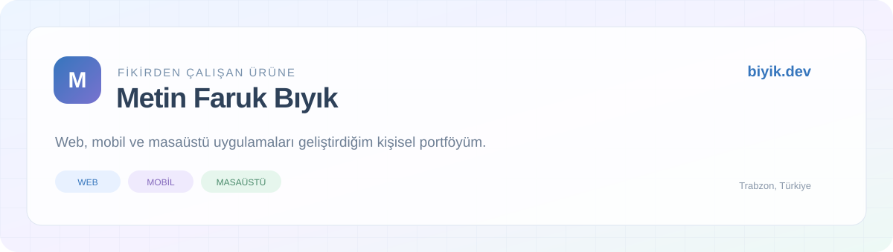

<p align="center">
  <a href="https://biyik.dev">
    
  </a>
</p>

<p align="center">
  <a href="https://biyik.dev"></a>
  <a href="https://biyik.dev/projeler"></a>
  <a href="https://biyik.dev/iletisim"></a>
</p>

<p align="center">
  
  
  
  
  
  
</p>

<p align="center">
  <strong>İhtiyaçtan doğan fikirler, çalışan ürünlere dönüşüyor.</strong><br>
  Geliştirdiğim uygulamaları, web sitelerini ve mesleki deneyimimi bir araya getiren kişisel portföy.
</p>

<p align="center">
  <a href="#-özellikler">Özellikler</a> ·
  <a href="#-projeler">Projeler</a> ·
  <a href="#-yerel-kurulum">Kurulum</a> ·
  <a href="#-proje-yapısı">Proje yapısı</a> ·
  <a href="#-seo-ve-erişilebilirlik">SEO</a> ·
  <a href="#-iletişim">İletişim</a>
</p>

---

## ✨ Özellikler

- **Sade arayüz:** Açık renkler, ince ızgara deseni ve mobil ekranlara uyumlu düzen.
- **Proje keşfi:** Uygulama ve web sitesi kategorileri; Türkçe arama, filtreleme ve boş sonuç ekranı.
- **Ürün sayfaları:** Ortak tanıtım düzeni, platform bilgileri, görseller ve indirme bağlantıları.
- **Profesyonel profil:** Deneyim, eğitim, sertifikalar, ekipmanlar ve indirilebilir özgeçmiş.
- **İletişim:** E-posta ve sosyal medya bağlantıları; tek telefon satırında arama / WhatsApp seçimi.
- **Arama ve paylaşım:** Sayfaya özel metadata, sosyal paylaşım görselleri ve yapılandırılmış veriler.

## 🧩 Projeler

### Uygulamalar

- 🎵 **[BYK Music](https://biyik.dev/projeler/byk-music)** — Windows ve Apple Silicon macOS için YouTube MP3 / MP4 indirme uygulaması. [Kaynak kodu ↗](https://github.com/metinfarukbiyik/byk-music)
- 📍 **[GeoCam: Audit](https://biyik.dev/projeler/geocam)** — iPhone fotoğraflarına GPS, adres ve zaman damgası ekleyen saha kamerası.
- 🏷️ **[BYK Seri Baskı Pro](https://biyik.dev/projeler/byk-seri-baski-pro)** — Excel listelerinden toplu barkod ve seri numarası etiketi hazırlayan masaüstü programı. [Kaynak kodu ↗](https://github.com/metinfarukbiyik/bykseripro)

### Web ve kurumsal çözümler

- 🌐 **[biyik.dev](https://biyik.dev/projeler/biyik-dev)** — Kişisel portföy ve özgeçmiş sitesi.
- 📚 **[Elif Öğretmen](https://biyik.dev/projeler/elif-ogretmen)** — Türkçe öğretmeni tanıtım sitesi.
- 🧯 **[BAYEN](https://biyik.dev/projeler/bayen)** — Yangın güvenliği ve yapı sistemleri için kurumsal web sitesi.
- 🗂️ **[Creda System](https://biyik.dev/projeler/creda-system)** — Personel, eğitim ve iş emri takibini birleştiren kurumsal sistem.

Tüm proje detayları **`/projeler/<proje-adı>`** adres yapısını kullanır.

## 🚀 Yerel kurulum

**Gereksinimler:** Node.js **22.12+** ve npm. Bu alt sınır, depodaki Sanity bağımlılığının gereksinimini de karşılar.

```bash
git clone https://github.com/metinfarukbiyik/metinfarukbiyik.git
cd metinfarukbiyik
npm ci
npm run dev
```

Geliştirme sunucusu: **[localhost:3000](http://localhost:3000)**

### Üretim ve kontroller

```bash
# TypeScript kontrolü
npx tsc --noEmit

# Üretim derlemesi
npm run build

# Derlenen uygulamayı başlat
npm run start
```

`next/font/google` üzerinden yüklenen yazı tipleri için ilk derlemede ağ erişimi gerekir.

### İsteğe bağlı Sanity bağlantısı

Portföy ve proje içerikleri `src/data/` içinden gelir. Sanity Studio’yu kullanmak için kökte `.env.local` dosyası oluşturup kendi proje bilgilerini ekle:

```dotenv
NEXT_PUBLIC_SANITY_PROJECT_ID=your-project-id
NEXT_PUBLIC_SANITY_DATASET=production
```

Yapılandırma tamamlandığında editör **`/studio`** adresinden açılır. CMS webhook’u kullanılacaksa `REVALIDATE_SECRET` değişkenini de tanımla; `/api/revalidate` isteği bu değeri `x-webhook-secret` başlığında doğrular.

> Gerçek token ve gizli anahtarları `.env.local` içinde tut. Bu dosya Git tarafından yok sayılır; herkese açık dokümanlara eklenmemelidir.

## 🗺️ Sayfalar

- **`/`** — Profil ve proje özeti.
- **`/hakkimda`** — Özgeçmiş, eğitim, deneyim ve sertifikalar.
- **`/projeler`** — Aranabilir ve filtrelenebilir proje listesi.
- **`/projeler/<proje-adı>`** — Uygulamaya veya web projesine özel detay sayfası.
- **`/iletisim`** — Telefon, WhatsApp, e-posta ve sosyal medya.
- **`/studio`** — İsteğe bağlı Sanity içerik editörü.

## 📁 Proje yapısı

```text
src/
├── app/
│   ├── (site)/         # Portföy sayfaları ve ortak site düzeni
│   ├── api/revalidate/ # İçerik önbelleğini yenileme uç noktası
│   ├── og/             # Dinamik sosyal paylaşım görselleri
│   ├── studio/         # Sanity Studio
│   ├── globals.css     # Renkler, bileşen stilleri ve responsive düzen
│   ├── robots.ts
│   └── sitemap.ts
├── components/         # Menü, ürün tanıtımı, galeriler ve listeler
├── data/               # Profil, projeler ve uygulama içerikleri
├── lib/                # SEO, site ayarları ve App Store bilgileri
└── sanity/             # Sanity yapılandırması ve içerik şemaları
public/                 # Uygulama görselleri, ikonlar ve özgeçmiş PDF’i
docs/                   # SEO notları ve README görselleri
```

### İçerikleri güncelleme

- **Profil ve iletişim:** [`src/data/cvData.ts`](src/data/cvData.ts)
- **Projeler ve anahtar kelimeler:** [`src/data/projects.ts`](src/data/projects.ts)
- **GeoCam içerikleri:** [`src/data/geocamData.ts`](src/data/geocamData.ts)
- **BYK Seri Baskı Pro içerikleri:** [`src/data/bykData.ts`](src/data/bykData.ts)
- **Site adresi ve menü:** [`src/lib/site.ts`](src/lib/site.ts)
- **Tasarım ve renkler:** [`src/app/globals.css`](src/app/globals.css)

## 🔎 SEO ve erişilebilirlik

- Özgün başlıklar, açıklamalar, anahtar kelimeler ve canonical adresler.
- Open Graph / Twitter kartları ve `/og` üzerinden üretilen paylaşım görselleri.
- `Person`, `WebSite`, `ContactPage`, `ItemList` ve proje türüne uygun JSON-LD şemaları.
- Otomatik `sitemap.xml` ve `robots.txt`.
- Eski uygulama adreslerinden yeni `/projeler/...` adreslerine **308 kalıcı yönlendirme**.
- Klavye odağı, içeriğe geç bağlantısı ve azaltılmış hareket tercihi desteği.

Proje bazındaki anahtar kelimeler ve uygulama ayrıntıları: **[SEO dokümanı](docs/seo.md)**.

## 💬 İletişim

<p>
  <a href="https://biyik.dev/iletisim"></a>
  <a href="https://www.linkedin.com/in/metinbiyik/"></a>
  <a href="https://instagram.com/_metinbiyik"></a>
</p>

---

<p align="center">
  <strong>Metin Faruk Bıyık</strong> · Trabzon, Türkiye<br>
  <a href="https://biyik.dev">Fikirden çalışan ürüne.</a>
</p>
